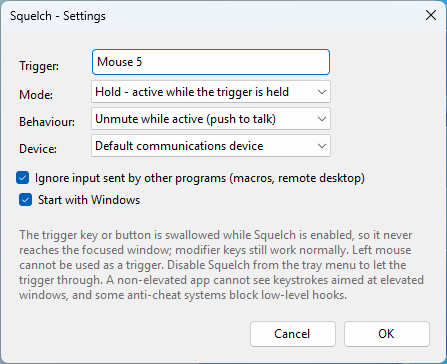
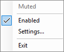

# Squelch

## Note: everything in this project is vibe-coded.

A Windows tray utility that mutes/unmutes the default microphone while you hold a key or mouse
button (or toggles it, if you prefer). Built with .NET 9 + WinForms, global input via low-level
Win32 hooks, and microphone control via the Core Audio API.

## Screenshots

| Settings | Tray menu |
| --- | --- |
|  |  |

## Build and run

```powershell
dotnet build -c Release
.\bin\Release\net9.0-windows\Squelch.exe
```

There is no main window. Look for the walkie-talkie icon in the notification area; right-click it
for **Settings**, **Enabled** and **Exit**, or double-click for settings.

### Single-file publish

```powershell
# ~1 MB: needs the .NET Desktop Runtime installed on the target machine.
dotnet publish -c Release -p:SelfContained=false
```
